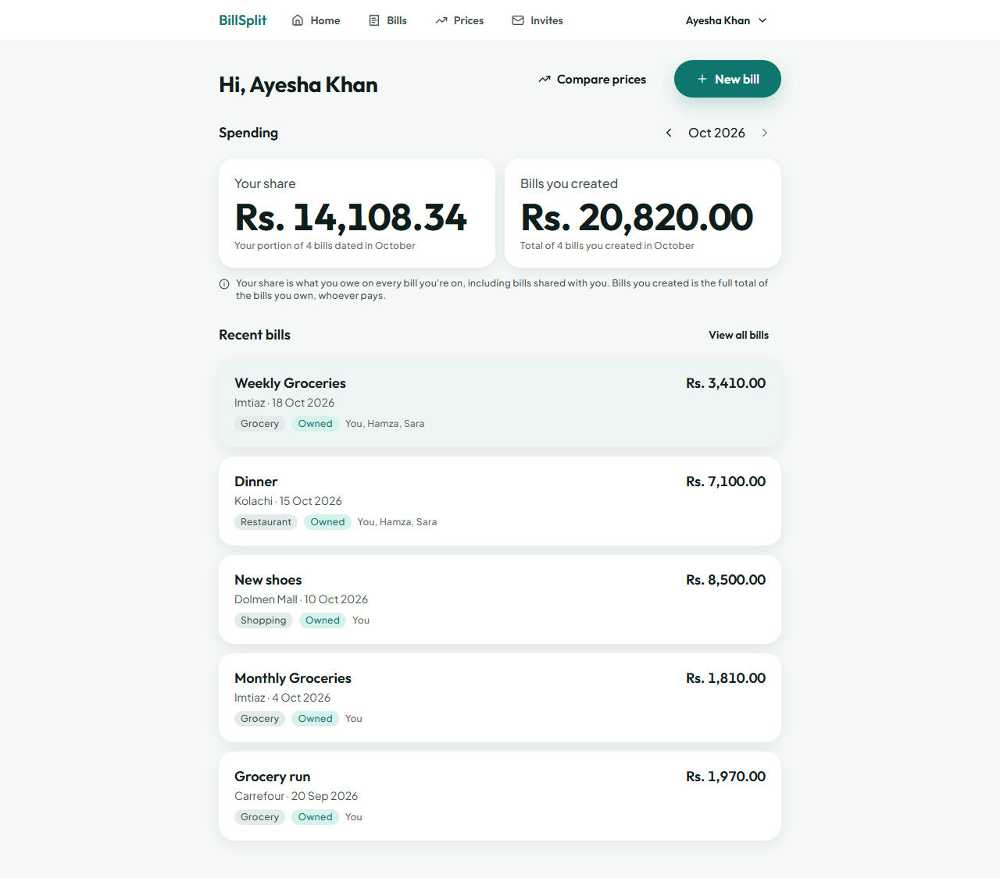
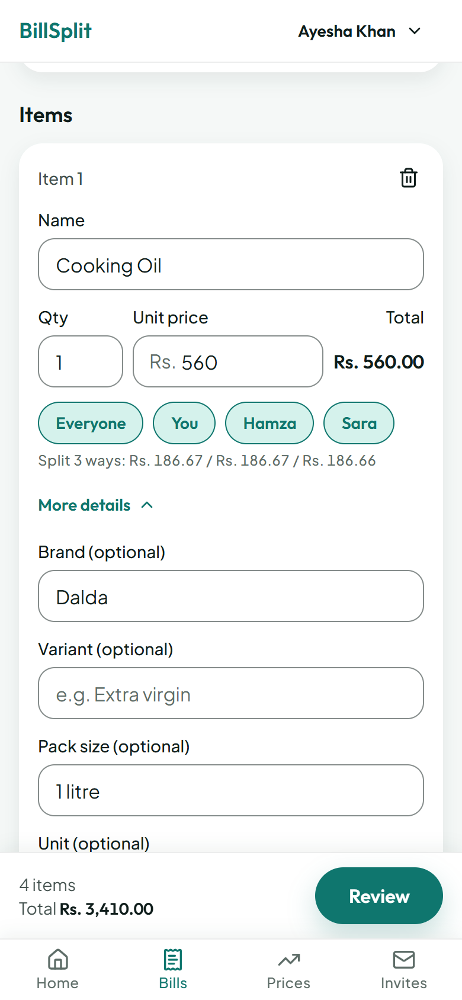
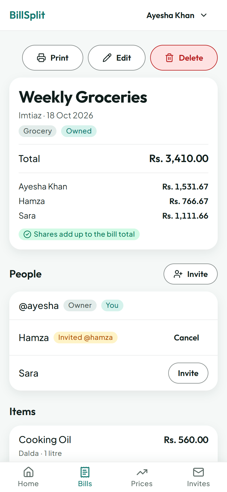
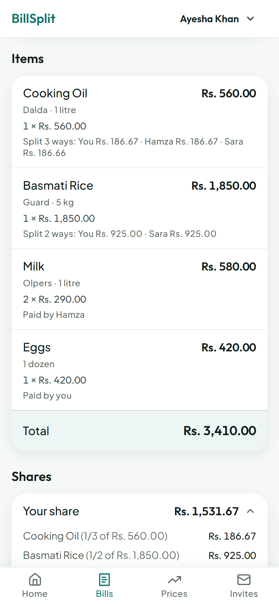
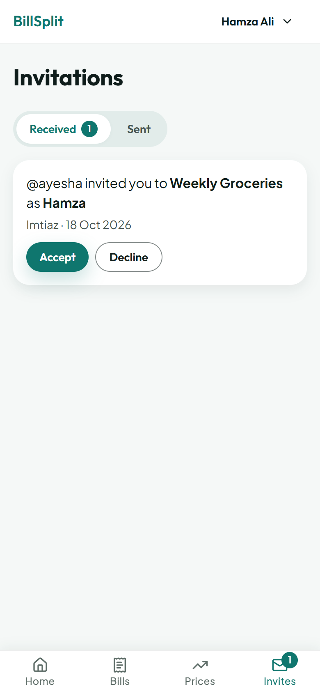
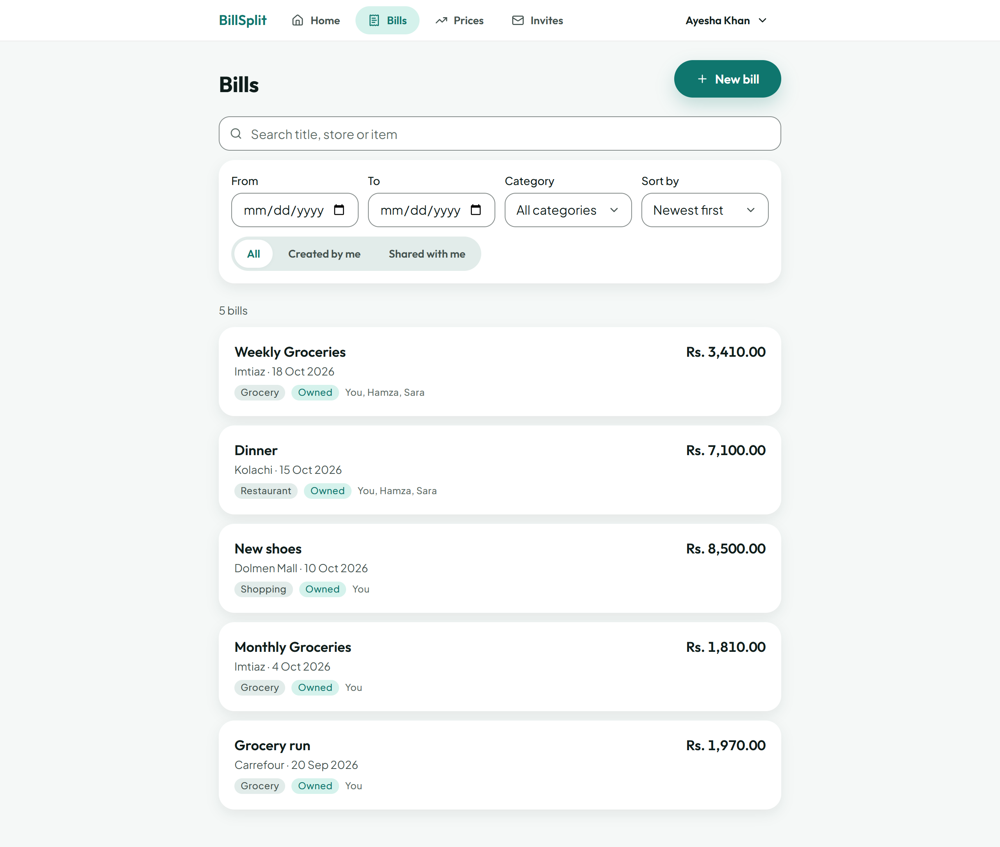
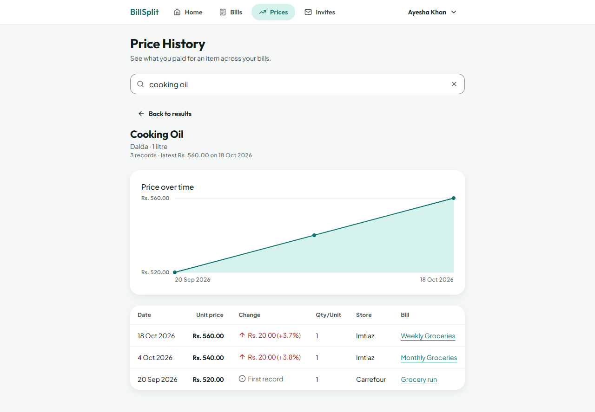
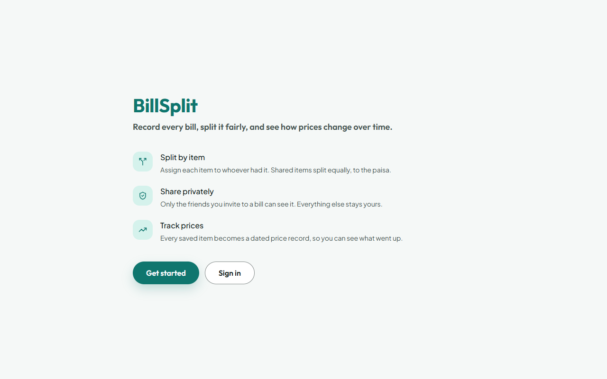

# BillSplit & Price History

A private web app for recording shopping and restaurant bills, splitting them fairly **by item**, sharing them only with the people involved, and seeing how item prices change over time. All amounts are in Pakistani rupees (PKR).

**Live:** [the-bill-split.vercel.app](https://the-bill-split.vercel.app)

<p align="center">
  
</p>

## Contents

- [Features](#features)
- [Screenshots](#screenshots)
- [How splitting works](#how-splitting-works)
- [Tech stack](#tech-stack)
- [Architecture](#architecture)
- [Getting started](#getting-started)
- [Environment variables](#environment-variables)
- [Scripts](#scripts)
- [Testing](#testing)
- [Project layout](#project-layout)
- [Authentication](#authentication)
- [Styling rules](#styling-rules)
- [Deploying to production](#deploying-to-production)
- [Known limits](#known-limits)
- [Documentation](#documentation)

## Features

- **Bills.** Record a shopping trip or meal with its title, store, date, category (Grocery, Restaurant, Shopping, Other) and items. Each item has a name, quantity, unit price and optional brand, variant, pack size and unit. Line totals and the running bill total update as you type.
- **Split by item.** Add anyone to a bill by typing a name; they don't need an account. Assign each item to one person, several people or **Everyone**. Every person gets an exact share, and a check confirms the shares add up to the bill total.
- **Split summary.** The bill page opens with a compact card (total plus one line per person) sized to fit a single phone screenshot, ready to send in any chat app.
- **Sharing.** The owner can link a person on the bill to a registered account by username or email. The invitee accepts or declines on the **Invitations** page; once accepted they can view the bill read-only. Names are never matched to accounts automatically, and linking never changes the split.
- **Bill History.** Search by title, store or item name; filter by date range, category and *Created by me / Shared with me*; sort by date or total.
- **Price History.** Search for an item and pick the exact product (brand, variant and pack size are kept apart). See every price you recorded for it with the change from the previous record (in rupees and percent), a price-over-time chart, and links back to each bill.
- **Item suggestions.** While entering an item, earlier products are suggested with their last price, so the same product is recorded the same way each time.
- **Spending summary.** The dashboard shows two monthly figures, never mixed: **Your share** (what you owe across every bill you're on) and **Bills you created** (the full totals of bills you own).
- **Print.** Any bill can be printed on one page with every person's breakdown.
- **Privacy.** A bill is visible only to its owner and the accounts they linked. Other users never see your account name or email; only usernames are shown.

Out of scope by design: payments and settlement tracking, separate tax, tip and fee lines, unequal splits, receipt scanning, email notifications, and shared editing.

## Screenshots

### Splitting a bill (phone)

<table>
  <tr>
    <td align="center" width="33%"><br><sub>Enter items and choose who pays</sub></td>
    <td align="center" width="33%"><br><sub>Split summary, one screenshot to share</sub></td>
    <td align="center" width="33%"><br><sub>Item breakdown and each share</sub></td>
  </tr>
</table>

### Sharing with a linked account

<p align="center">
  
</p>

### Bill History

<p align="center">
  
</p>

### Price History

<p align="center">
  
</p>

### Landing page

<p align="center">
  
</p>

## How splitting works

All amounts are integer **paisa** (Rs. 1 = 100 paisa) and quantities are integer thousandths (1.5 kg = 1500), so no money is ever stored as a floating-point number.

1. **Line total** = quantity × unit price, rounded half-up to the nearest paisa.
2. An item assigned to **one** person is charged entirely to them.
3. An item assigned to **several** people is split equally. Any leftover paisa go one each to the people earliest on the bill (the owner first, then in the order people were added), so the shares always add up to the line total exactly.
4. A person's share is the sum of their parts of every item. The bill total is the sum of all line totals, and the shares always reconcile with it.

Example: a Rs. 5,000 pizza split three ways is Rs. 1,666.67 + Rs. 1,666.67 + Rs. 1,666.66 = Rs. 5,000.00.

The rules live in `src/domain/money.ts`. Both the form preview and the server use them, and the server re-parses and recomputes everything it saves.

## Tech stack

| Layer | Choice |
|---|---|
| Framework | [Next.js](https://nextjs.org) 16 (App Router) with React 19 and TypeScript (strict) |
| Backend and database | [Convex](https://convex.dev): queries, mutations and reactive live updates |
| Authentication | [Convex Auth](https://labs.convex.dev/auth): email and password |
| Styling | Tailwind CSS v4 driven entirely by design tokens (`design/tokens.css`) |
| UI components | shadcn/ui-style components on Radix primitives; lucide-react icons |
| Tests | Vitest, with [convex-test](https://docs.convex.dev/testing/convex-test) for the backend |
| Hosting | Vercel (frontend) and Convex Cloud (backend) |

## Architecture

- **Convex is the backend and the only authority.** Every exported query and mutation in `convex/*.ts` starts with an auth helper from `convex/lib/auth.ts` (`getCurrentUser`, `requireCurrentUser`, `requireOnboardedUser`, `requireTripOwner`). Access to a bill comes only from a `tripPeople` row linking the caller's account to it: the owner, or a person whose invitation was accepted. Inaccessible bills look exactly like missing ones (`null` / `NOT_FOUND`). No function takes a user ID as the caller's identity. There are no Next.js API routes.
- **Live data.** Pages under `src/app/(app)/` render on the client once the signed-in user has loaded and read data through Convex's reactive queries. Changes such as an accepted invitation or an edited bill appear without a reload.
- **Bounded reads.** Every query reads through an index with `.take(cap)`, `.first()` or `.unique()`; nothing calls `.collect()`. See [Known limits](#known-limits).
- **Shared domain logic.** `src/domain/` holds pure TypeScript (money, validation, normalization, price changes, chart geometry) used by both the UI and the backend.
- **Service boundaries.** Only `src/lib/db/` talks to Convex and only `src/lib/auth/` talks to Convex Auth. They return plain app types and turn every error into a friendly message (`toAppError`, `toAuthError`), so the UI never shows technical details. ESLint enforces these boundaries.

### Data model

| Table | Holds |
|---|---|
| `users` | Name, email (lowercase), username. Created by Convex Auth at sign-up. |
| `trips` | One bill: owner, title, store, date (`YYYY-MM-DD`), category, total, search text |
| `tripPeople` | Everyone a bill is split between: the owner and typed names, in a fixed order; `userId` is set once a person is linked to an account |
| `tripInvitations` | A request to link one person on a bill to one account: pending, accepted, declined, cancelled or unlinked |
| `items` | Item records with a `productMatchKey` used for Price History; each belongs to exactly one bill |
| `itemAssignments` | Each person's exact share (in paisa) of each item |

Price History is derived from the `items` of the bills you can access. There is no separate "current price" field, so editing one bill never changes another.

## Getting started

### Prerequisites

- Node.js 22.12+ or 24 (required by Vitest), and npm
- A free [Convex](https://convex.dev) account. Sign-in uses email and password through Convex Auth, so no other service is needed.

### Setup

```bash
npm install            # also applies patches/ via patch-package

# 1. Connect to Convex. Log in, then create or choose a project.
#    This writes CONVEX_DEPLOYMENT, NEXT_PUBLIC_CONVEX_URL and NEXT_PUBLIC_CONVEX_SITE_URL to .env.local.
#    Keep it running while you develop.
npx convex dev

# 2. Once per Convex deployment, in a second terminal:
#    sets SITE_URL, JWT_PRIVATE_KEY and JWKS on the deployment.
npx @convex-dev/auth --web-server-url http://localhost:3000

# 3. Start the app at http://localhost:3000
npm run dev
```

Then open the app, **Get started**, sign up with a name, email and password, and choose a username.

### Test accounts

There's no email verification, so test accounts are created by signing up in the app. For manual testing use **Alice** (`alice@example.com`, the bill owner), **Bob** (`bob@example.com`, an invitee) and **Carol** (`carol@example.com`, unrelated), each with a development-only password such as `testpass123`, in separate browser profiles or private windows. People without accounts are just names typed on a bill (e.g. Ben, Sara). To test linking someone later, sign up **Ben Doe** with the username `ben_doe`. Never reuse these passwords on production data.

## Environment variables

See [.env.example](.env.example). Auth keys live on the Convex deployment, never in `.env.local` or the repo.

| Variable | Where | Set by |
|---|---|---|
| `CONVEX_DEPLOYMENT` | `.env.local` | `npx convex dev` |
| `NEXT_PUBLIC_CONVEX_URL` | `.env.local` (dev); injected by `npx convex deploy` on Vercel | `npx convex dev` / `npx convex deploy` |
| `NEXT_PUBLIC_CONVEX_SITE_URL` | `.env.local` | `npx convex dev` |
| `SITE_URL` | Convex deployment | `npx @convex-dev/auth` (dev), `npx convex env set --prod SITE_URL …` (prod) |
| `JWT_PRIVATE_KEY`, `JWKS` | Convex deployment | `npx @convex-dev/auth` (generated; separate keys per deployment) |
| `CONVEX_DEPLOY_KEY` | Vercel (production) | Copied from the Convex dashboard |

The two `NEXT_PUBLIC_` values are public URLs, not secrets. No secret ever reaches the browser, and only `src/lib/db/client.ts` reads an environment variable in the app.

## Scripts

| Script | What it does |
|---|---|
| `npm run dev` | Start the Next.js dev server |
| `npm run build` | Production build |
| `npm start` | Serve the production build |
| `npm run typecheck` | TypeScript check of the app and of `convex/` |
| `npm run lint` | ESLint, including the design-token and service-boundary rules |
| `npm test` | Run all tests once |
| `npm run test:watch` | Run the tests in watch mode |
| `npm run check` | typecheck + lint + test; run before every commit |

## Testing

`npm test` runs two Vitest projects:

- **`unit`** (`tests/unit/`): domain logic such as money parsing and rounding (including 500 random bills that must reconcile), validation, normalization, price changes, chart geometry and form state.
- **`convex`** (`tests/convex/`): the real Convex functions running in `convex-test`. They cover bill creation and editing, invitations, Bill History, Price History, the spending summary, and a full **permission matrix**: owner, linked, pending, declined, cancelled, unlinked, removed, unrelated and signed-out callers against every read and write.

## Project layout

```text
convex/               Backend: schema, queries, mutations, Convex Auth setup
  lib/                Auth and access checks, bounded-read caps, write helpers, read models
  _generated/         Written by the Convex CLI; never edit
design/               tokens.css (every colour, size, radius, shadow, font, motion) and fonts.ts
src/
  app/                Next.js App Router routes
    (public)/         Landing page
    (auth)/           Sign in, sign up
    (onboarding)/     Choose a username
    (app)/            Dashboard, bills, new/edit bill, invitations, price history, settings
  components/         UI: ui/ (primitives), layout/, and feature folders (trips, bills, …)
  domain/             Pure TypeScript business logic shared by the UI and the backend
  lib/db/             The only frontend code that talks to Convex
  lib/auth/           The only frontend code that talks to Convex Auth
  proxy.ts            Next.js proxy (formerly "middleware"): sessions and route redirects
tests/unit/           Domain unit tests
tests/convex/         Backend tests, including permissions
patches/              patch-package fix for Convex Auth (see below)
docs/                 Build plan, progress log, screenshots
```

## Authentication

Email and password through Convex Auth's Password provider, configured in `convex/auth.ts`. Sessions live in httpOnly cookies for 30 days. `src/proxy.ts` redirects signed-out visitors away from app pages, and signed-in users away from `/`, `/sign-in` and `/sign-up`. That's only a convenience: every Convex function checks the caller itself.

`convex/auth.ts` wraps the Password provider for two reasons. Signing up with an existing email always fails; Convex Auth would otherwise sign the caller in when the password matches. And sign-in and sign-up failures reach the UI as coded `ConvexError`s, which production deployments don't redact.

Convex Auth's Next.js proxy forwards only an error's message to the browser, and production redacts that message. So `patches/@convex-dev+auth+0.0.96.patch` makes the proxy also forward the `ConvexError`'s data. `patch-package` applies it on every `npm install` and fails loudly if Convex Auth is upgraded; check whether the new version still needs it before regenerating it.

## Styling rules

`design/tokens.css` resets Tailwind's default theme (`--*: initial`), so default classes like `bg-white` or `p-3` produce nothing. Use token classes only (`bg-primary`, `p-16`, `type-body`, `rounded-md`, …). Inline `style`, hex or rgb colours and arbitrary values like `p-[13px]` fail lint. To add a value, add a token first. Contributor rules are in [RULES.md](RULES.md).

## Deploying to production

1. In the Convex dashboard, create the production deployment, then generate its own auth keys (never reuse the dev keys):
   ```bash
   npx @convex-dev/auth --prod
   ```
2. In Vercel, import the repository and:
   - set the **Build Command** to `npx convex deploy --cmd 'npm run build'`;
   - add `CONVEX_DEPLOY_KEY`, a production deploy key from the Convex dashboard (the `deployment:deploy` permission is enough). `convex deploy` pushes the functions and injects `NEXT_PUBLIC_CONVEX_URL` into the build. No auth variables go in Vercel.
3. Deploy, then point Convex Auth at the live URL:
   ```bash
   npx convex env set --prod SITE_URL https://<app>.vercel.app
   ```

If any step differs, check the current [Convex + Vercel guide](https://docs.convex.dev/production/hosting/vercel) and the [Convex Auth production docs](https://labs.convex.dev/auth/production).

## Known limits

Every read is bounded. The caps live in `convex/lib/access.ts` unless noted:

| Limit | Value | Applies to |
|---|---|---|
| `ACCESSIBLE_TRIPS_CAP` | 1000 | Bills considered for the dashboard, history, price history and summaries |
| `PRODUCT_SEARCH_TRIPS_CAP` | 300 | Bills searched for products and item suggestions |
| `RECENT_TRIPS_LIMIT` | 5 | Dashboard "Recent bills" |
| `HISTORY_PAGE_SIZE` | 20 | Bill History "Load more" step |
| `MAX_HISTORY_LIMIT` | 200 | Bills shown for one Bill History search (narrow the filters to find others); `src/domain/bill-history.ts` |
| `MAX_HISTORY_SEARCH_LENGTH` | 80 | Characters in a Bill History search; `src/domain/bill-history.ts` |
| `PRODUCT_RESULTS_LIMIT` | 20 | Products returned by one Price History search; `src/domain/price-history.ts` |
| `ITEM_SUGGESTIONS_LIMIT` | 8 | Item suggestions while entering an item; `src/domain/price-history.ts` |
| `MAX_PRODUCT_SEARCH_LENGTH` | 80 | Characters in a Price History search (at least 2 to search); `src/domain/price-history.ts` |
| `MAX_OBSERVATIONS` | 200 | Price records shown for one product, newest first (changes are computed over all of them); `src/domain/price-history.ts` |
| `MAX_ITEMS_PER_TRIP` | 200 | Items on one bill; `src/domain/trip-validation.ts` |
| `MAX_PEOPLE_PER_TRIP` | 20 | People on one bill, including the owner; `src/domain/trip-validation.ts` |
| `INVITATION_LIST_LIMIT` | 50 | Invitations shown on Received and Sent (the nav badge shows "50+"); `convex/invitations.ts` |

## Documentation

- [PRD.md](PRD.md): product requirements
- [docs/BUILD_PLAN.md](docs/BUILD_PLAN.md): the full build plan
- [docs/PROGRESS.md](docs/PROGRESS.md): progress log with every decision and verification pass
- [RULES.md](RULES.md): coding rules for contributors and agents

Screenshots were taken from a local production build with demo data.
